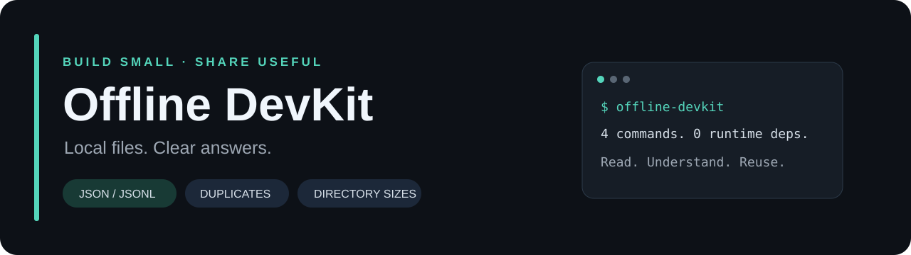
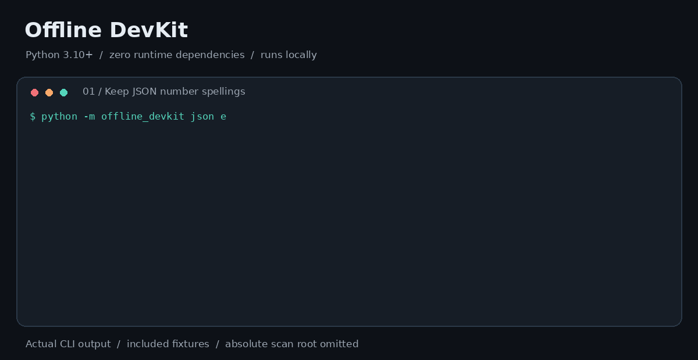

<p align="center"></p>

# Offline DevKit

[](https://github.com/lashonbakker-crypto/offline-devkit/actions/workflows/ci.yml)

**本地检查 JSON / JSONL，保留数字原文，找出重复文件和大文件。**

Local data checks, exact JSON numbers, and read-only file reports. **Python 3.10+ · Zero runtime dependencies · MIT.**

[English](README.en.md) · [单文件下载](https://github.com/lashonbakker-crypto/offline-devkit/releases/latest) · [快速开始](#一分钟上手) · [完整命令](docs/usage.md) · [贡献指南](CONTRIBUTING.md)

一个用 Python 标准库实现的轻量命令行工具箱。适合检查配置文件、日志、JSONL 数据集，以及整理下载目录和备份；处理过程在本机完成。可直接使用，也可阅读源码学习命令行、文件系统和自动测试。

| 工具 | 解决什么问题 | 实现亮点 |
| --- | --- | --- |
| `json` | 配置文件难读、重复键、非标准数字 | 保留数字原文，拒绝重复键与 `NaN` / `Infinity` |
| `jsonl` | 日志或数据集中某一行有问题 | 逐行检查、准确行号、单行大小限制；可用 `--gzip` 直接检查压缩日志 |
| `dupes` | 下载目录、资料备份里有重复内容 | 大小与 SHA-256 筛选；可选逐字节复核；硬链接只算一次 |
| `sizes` | 想知道哪个子目录、哪些文件最大 | 汇总一级目录，输出最大文件与机器可读报告 |

### 30 秒看懂



演示来自附带示例的实际命令输出。可复现步骤见[演示说明](docs/demo.md)。觉得有用，可以点 **Star** 收藏，也欢迎用 Issue 分享实际遇到的问题。

## 一分钟上手

**方式一：下载一个文件。** 在 [Releases](https://github.com/lashonbakker-crypto/offline-devkit/releases/latest) 下载 `offline-devkit.pyz`，有 Python 3.10+ 就能运行，适合在多台电脑间携带：

```bash
python offline-devkit.pyz --help
python offline-devkit.pyz sizes . --top 5
```

下载后可按[校验说明](docs/publishing.md)检查 SHA-256。

从 v0.4.0 起，可直接校验 gzip 压缩的 JSONL / NDJSON：

```bash
python offline-devkit.pyz jsonl records.jsonl.gz --gzip --json
```

显式添加 `--gzip`，文件后缀不触发自动解压。行号和大小限制按解压后的记录计算；压缩流截断、CRC 或格式错误会令 `complete=false` 并返回 2，即使已经读到的行都有效。详见[压缩日志示例与边界](docs/05-gzip-jsonl.md)。

无需 pip 或构建工具。Windows 可用 `py -3`；macOS / Linux 可用 `python3`。下载需要网络，下载后的运行不需要网络。

**方式二：从源码试用附带示例。**

克隆仓库后进入项目目录。以下方式直接运行源码，无需安装包，也不需要联网：

```bash
git clone https://github.com/lashonbakker-crypto/offline-devkit.git
cd offline-devkit
python -m offline_devkit json examples/config.json
python -m offline_devkit jsonl examples/records.jsonl
python -m offline_devkit dupes examples/files
python -m offline_devkit sizes examples/files --top 3
```

克隆需要网络，下载源码 ZIP 后解压也可以；进入目录后的工具命令不需要网络。

Windows 如果没有 `python` 命令，请用 `py -3`；macOS / Linux 可以用 `python3`。

附带的三个文本文件中，`note.txt` 和 `copies/note-copy.txt` 内容相同，`unique.txt` 内容不同。你应看到一组重复文件。检查配置示例时，长小数和 `1E-400` 会保持原样。

可选：安装到虚拟环境，使 `offline-devkit` 在其他目录也能使用：

```bash
python -m venv .venv
# macOS / Linux
source .venv/bin/activate
# Windows PowerShell：.\.venv\Scripts\Activate.ps1
python -m pip install .
offline-devkit --help
```

安装步骤可能需要下载构建工具 `setuptools`。安装完成后的工具运行，以及上面的源码运行方式，都不需要网络。目前没有承诺在 PyPI 发布，请从本仓库安装。

## 四个日常用法

### 检查 JSON，或生成可读的新文件

```bash
python -m offline_devkit json examples/config.json --check
python -m offline_devkit json examples/config.json --sort-keys > formatted.json
```

`--check` 成功时没有输出，适合脚本检查。输入必须是 UTF-8，允许开头一个 BOM，拒绝重复 BOM，大小上限为 16 MiB。格式化保留数字字符序列，包括指数、大整数、长小数与 `-0`；字符串的转义方式和空白可能变化。

命令输出统一使用 UTF-8 和 LF 换行，包括 Windows 上的重定向输出。`--check` 与格式化的可处理嵌套深度可能不同，取决于 Python 的解码器和递归限制；超出能力时会报告错误。

### 定位 JSONL / NDJSON 的坏行

```bash
python -m offline_devkit jsonl examples/records.jsonl
python -m offline_devkit jsonl examples/invalid-records.jsonl --json
```

第一条命令检查 3 行，全部有效；第二条命令报告第 2 行重复键、第 3 行 `NaN`，并返回退出码 2。可以用在日志、数据集或 CI 的格式检查中。

从其他程序接收数据，见[Bash / PowerShell 管道教程](docs/04-jsonl-pipelines.md)：分别保留生成器和校验器退出码，明确 UTF-8，并演示生成器中途失败的情况。

按行读取，默认每行最多 1 MiB（不含 LF / CRLF），只保留前 20 条错误但继续统计全部行。拒绝空白行、BOM、无效 UTF-8、重复键和非标准数字。允许顶层标量和没有末尾换行的最后一条记录。检查 JSON 语法与本工具的严格规则，不检查业务 schema 或特定平台的数据要求。详见[JSONL 说明](docs/03-jsonl.md)。

### 找出重复文件，先看清楚再处理

```bash
python -m offline_devkit dupes ./Downloads --min-size 1024 --exclude "*.tmp"
python -m offline_devkit dupes ./Downloads --verify-bytes --json
python -m offline_devkit dupes ./Downloads --json > duplicates-report.json
```

默认先按大小筛选，再用 SHA-256 分组。需要更强的内容证据时使用 `--verify-bytes`，它会对同哈希候选再做分块逐字节比较，并在 JSON 报告中标记 `verified_by: "bytes"`。这会多读取一遍候选内容，速度可能更慢。

工具只报告，**没有删除或修改文件的功能**。`redundant_bytes` 是冗余内容的逻辑字节估计，不代表真实可释放磁盘空间。报告中的第一条路径只是排序结果，不是建议保留的文件。

### 看目录大小，定位大文件

```bash
python -m offline_devkit sizes . --top 10
python -m offline_devkit sizes . --exclude "*.log" --json
```

默认跳过 `.git`、`.venv`、`venv`、`node_modules`、`__pycache__`、`.pytest_cache` 目录，以及符号链接和 Windows 重解析点。显式加 `--include-ignored` 可以纳入依赖与缓存目录；它仍然不会遍历链接。特殊文件（例如命名管道）不计入报告。

当前 `main` 优化了“从大量文件中选出前 N 个”的报告开销，并附有[可复现规模基准](docs/06-largest-files.md)。基准只测已收集元数据后的报告构造，不代表真实目录扫描速度；已发布的 v0.4.0 附件尚不包含此优化。

## 退出码

| 退出码 | 含义 |
| --- | --- |
| `0` | 完成，没有处理错误；普通重复文件报告发现重复仍返回 0 |
| `1` | 指定 `dupes --fail-if-found` 且发现重复组 |
| `2` | 参数或输入错误，或者扫描 / 读取不完整 |
| `130` | 用户中断 |

## 读代码与参与项目

| 入口 | 内容 |
| --- | --- |
| [命令手册](docs/usage.md) | 参数、输出字段、退出码、边界行为 |
| [实现原理](docs/how-it-works.md) | 为什么不能直接用浮点数格式化 JSON；如何避免误判重复文件 |
| [技术笔记 01](docs/01-json-numbers.md) | 用一个可以复现的例子理解 JSON 精度问题 |
| [技术笔记 02](docs/02-duplicates.md) | 文件大小、哈希、硬链接与目录扫描的区别 |
| [技术笔记 03](docs/03-jsonl.md) | 按行检查数据集、错误样本和读取边界 |
| [可复现演示](docs/demo.md) | README 动图对应的实际命令与输出 |
| [贡献指南](CONTRIBUTING.md) | 怎样报告问题、修改代码、运行测试 |
| [发布记录](CHANGELOG.md) | 当前版本及行为变动 |
| [路线图](ROADMAP.md) | 后续可以贡献的具体方向 |

核心代码在 [offline_devkit](offline_devkit/)，测试在 [tests](tests/)。

```bash
python -m unittest discover -s tests -v
```

CI 覆盖 Linux / Python 3.10、3.12、3.14，以及 Windows、macOS 15（Intel）/ Python 3.12，运行行为测试、安装检查和单文件包检查。**当前提交是否通过，请查看顶部徽章与 [Actions](https://github.com/lashonbakker-crypto/offline-devkit/actions)。**

## 使用边界

- 在稳定、可信的本地目录运行。扫描不是文件系统快照，也不是对恶意并发修改的隔离边界；检测到文件变化会报告错误，但无法检测所有竞态。
- 等待扫描的目录会在进入前、列出条目后重新核对。发现目录被替换为链接或其他目录时，跳过该目录、记录 `errors`，并返回退出码 2；这仍不能排除检查与使用之间的替换，或完全防护祖先目录的变化。详见[扫描边界](docs/usage.md#目录命令共同参数)。
- `sizes` 统计文件长度（逻辑大小），硬链接的每个路径都会计数；压缩、稀疏文件、写时复制、磁盘块占用不在本项目统计范围。
- SHA-256 相同是默认的重复内容判断依据；可用 `dupes --verify-bytes` 增加逐字节复核。扫描仍不是稳定快照，不能排除检查结束后的文件变化。
- 输出报告包含文件路径，分享报告前请检查内容。程序不发起网络请求；保存标准输出由你的 shell 负责。
- 不要将格式化结果重定向回原输入文件，也不要把目录扫描报告写入正在扫描的目录。用新文件或目录外的路径。

## 许可与来源

代码、示例和文档为本项目原创，使用 [MIT License](LICENSE)。[学习来源](docs/references.md)列出 Python 与 GitHub 官方文档；没有复制第三方项目的实现。
